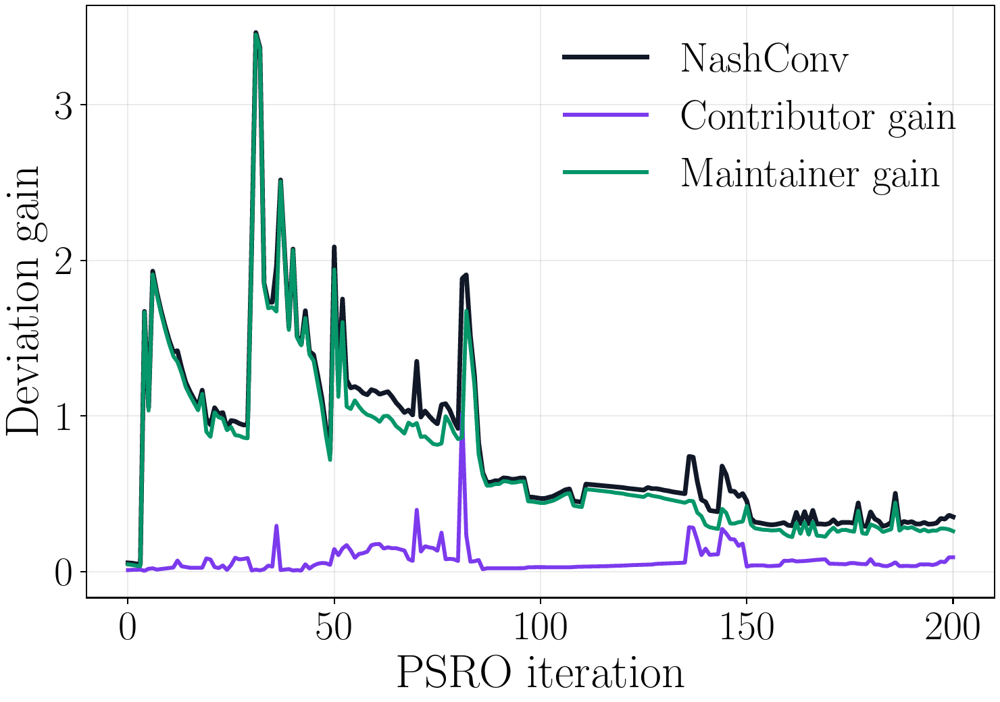
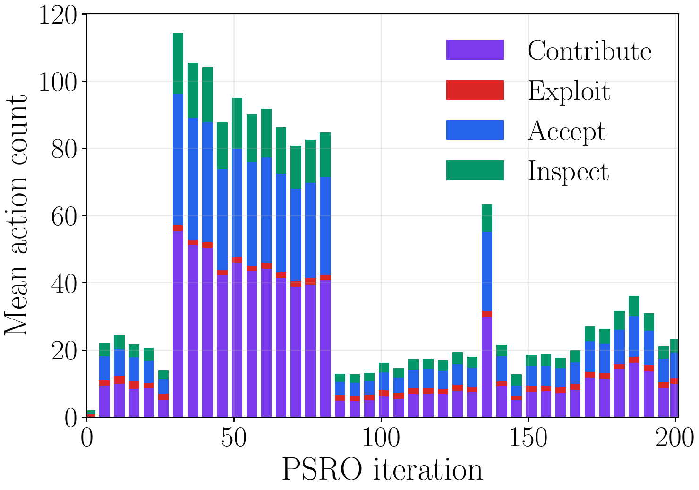

<div align="center">

# OSSGuard

### A game-theoretic framework for trust and security in open-source ecosystems

[](https://doi.org/10.1007/978-3-032-40367-4_29)
[](https://www.python.org/)
[](#methods)
[](#reproducibility)
[](LICENSE)

</div>

OSSGuard is a finite-horizon, two-player stochastic game for studying strategic trust management in open-source projects. A contributor chooses whether to contribute or exploit; a maintainer observes a noisy security signal and chooses whether to accept or inspect. The implementation includes the paper's heuristic policies, DQN response oracles, fixed-pool training schemes, empirical-game PSRO, and evaluation procedures.

**Paper:** [Springer chapter and DOI](https://doi.org/10.1007/978-3-032-40367-4_29) · **Citation:** see [CITATION.cff](CITATION.cff) and [citation instructions](#citation).

## Figure from the paper

The panels below are converted from the supplied paper figures. They show restricted-game deviation gains and average action counts during PSRO.

<p align="center">
  
  
</p>

*Figure rendered from the author-supplied paper figure PDFs: Javad Mokhtari Koushyar, Mina Guirguis, and George Atia, “OSSGuard: A Game-Theoretic Framework for Trust and Security in Open-Source Ecosystems,” GameSec 2026, pp. 582–601. Numeric results are not recomputed by the repository until experiments are run.*

## Installation

Python 3.10 or later is required. Install the package and its runtime dependencies in a virtual environment:

```bash
python -m venv .venv
source .venv/bin/activate
python -m pip install --upgrade pip
python -m pip install -e .
```

The DQN implementation uses PyTorch. CUDA is selected when available; otherwise it runs on CPU.

## Reproducibility

Each command accepts a seed and output directory. The default game and DQN parameters follow the experimental settings in the paper: horizon 200, maximum privilege 100, signal probabilities `[0.30, 0.60]`, `Ωmin = 3`, `βC = βM = 3`, exploit multipliers 3, DQN widths 120 and 84, learning rate `2.5e-4`, replay capacity 100,000, batch size 128, discount 0.95, target update period 2,000, training frequency 4, soft update `τ = 0.01`, learning starts at 1,000 steps, and ε anneals from 1.0 to 0.05 over half a response-oracle run. Evaluation defaults to 300 episodes per policy pair.

```bash
# Heuristic payoff matrix
ossguard heuristics --seed 42 --episodes 300 --output results/heuristics

# Fixed contributor pool, uniform MSS
ossguard fixed-pool --method mss-unif --epochs 100 \
  --steps-per-epoch 5000 --seed 42 --episodes 300 --output results/mss-unif

# Hard MSS and sequential IBR variants
ossguard fixed-pool --method mss-hard --seed 42 --output results/mss-hard
ossguard fixed-pool --method ibr --seed 42 --output results/ibr

# Expanding-population empirical-game PSRO
ossguard psro --iterations 200 --steps-per-oracle 5000 \
  --seed 42 --episodes 300 --output results/psro
```

Full paper-scale runs are computationally intensive. Start with smaller `--epochs`, `--steps-per-epoch`, `--iterations`, and `--episodes` values for a smoke run, and record the exact arguments and hardware alongside any reported results. Each run writes `run_metadata.json`; other outputs include CSV evaluation and training records, learned PyTorch checkpoints, and compressed empirical-game payoff/meta-strategy arrays where applicable. Evaluation seeds are derived deterministically from the run seed and policy indices.

## Methods

- **Game:** contributor action `C` or `X`; maintainer action `A` or `I`; binary noisy signal; privilege accumulation; absorbing detected-exploit state; finite-horizon truncation; privilege-dependent rewards.
- **Heuristics:** Random, Periodic, Gate, Ramp, Tough Start, Tough End, and Greedy with the paper's default parameters.
- **DQN:** two hidden ReLU layers (120, 84), experience replay, ε-greedy exploration, and target-network updates.
- **Fixed-pool population training:** MSS-Unif, MSS-Hard, IBR, and contributor-specific Specialists, followed by known-pool evaluation. Learned MSS policies also receive zero-shot evaluation on unseen heuristic parameterizations; MSS-Unif includes the frozen signal-quality sweep.
- **Full PSRO:** expands both policy populations, solves the restricted empirical bimatrix game, trains contributor and maintainer response oracles against the current meta-strategies, and records restricted-game NashConv.

The paper does not fully specify every implementation detail (for example, the equilibrium selection rule when the restricted game has multiple equilibria). This implementation uses Nashpy support enumeration for restricted games up to 12 policies per player, then regret matching for larger populations. Numerical values can also vary with hardware and library versions. Treat reported paper values as reference results; generated outputs are the results of the recorded local run.

The paper's posterior-threshold result is represented by the small, standalone helpers in `ossguard.theory`; these calculations are not added as a learned policy or training feature.

## Citation

If this code or the framework informs your work, cite the paper:

```bibtex
@incollection{koushyar2027ossguard,
  author    = {Javad Mokhtari Koushyar and Mina Guirguis and George Atia},
  title     = {OSSGuard: A Game-Theoretic Framework for Trust and Security in Open-Source Ecosystems},
  booktitle = {Game Theory and AI for Security},
  editor    = {Mingyan Liu and Parinaz Naghizadeh and Yevgeniy Vorobeychik},
  series    = {Lecture Notes in Computer Science},
  volume    = {17097},
  pages     = {582--601},
  publisher = {Springer},
  year      = {2027},
  doi       = {10.1007/978-3-032-40367-4_29}
}
```

Use the [Springer chapter record](https://doi.org/10.1007/978-3-032-40367-4_29) for the paper metadata. The software is distributed under the MIT License; see [LICENSE](LICENSE).

## Project site

A small, paper-focused landing page is in [`docs/`](docs/). The configured GitHub Pages address is [j0m0k0.github.io/OSSGuard](https://j0m0k0.github.io/OSSGuard/). Publish the `docs/` directory with GitHub Pages to make the sitemap and robots policy publicly discoverable by search engines.
